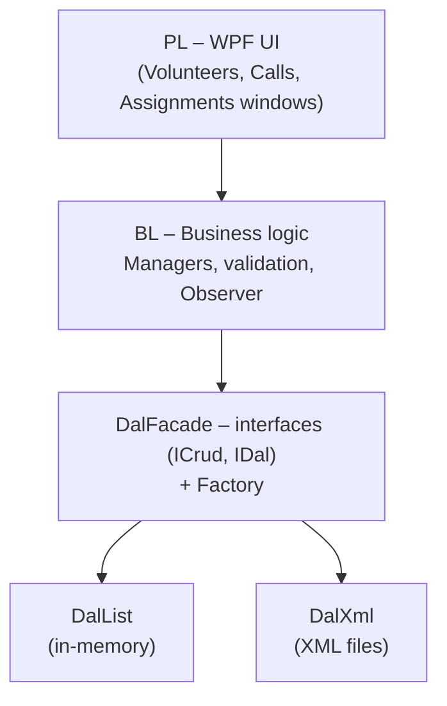

# Hospital Volunteer Management System

A desktop system for organizing hospital volunteers. Admins open calls (for example "help a nurse" or "escort a patient"), volunteers see open calls near them and take them on, and the system tracks every assignment until it's closed.

Built as a team project in C# / .NET 8, following a strict layered architecture.

## Features

- **Volunteers:** add, edit and list volunteers, with roles (admin / volunteer), active status and max travel distance
- **Calls:** open, assign, track and close calls; separate views for open, in-progress and closed calls
- **Distance calculation:** volunteers and calls have coordinates, and each open call shows its distance from the volunteer
- **Simulated clock:** an admin-controlled system clock running on a background thread, so call deadlines and expiry can be tested
- **Observer pattern** in the business layer, so the UI can subscribe to data changes

## Architecture

- **DalFacade** defines the data interfaces (`ICrud<T>`, `IDal`) and the data objects
- **DalList** and **DalXml** are two interchangeable data layers – in-memory lists or XML files – picked at runtime from a config file through a factory
- **BL** holds the business rules, business objects and helper managers, exposed through `IBl` interfaces
- **PL** is a WPF app that talks only to the BL
- **DalTest / BLTest** are console apps for testing each layer on its own, with generated sample data

## Tech

C#, .NET 8, WPF, XAML, LINQ, XML (LINQ to XML), multithreading, design patterns (Factory, Singleton, Observer)

## Run it

Open `HospitalNet.sln` in Visual Studio 2022 and set **PL** as the startup project (Windows only, for WPF).
